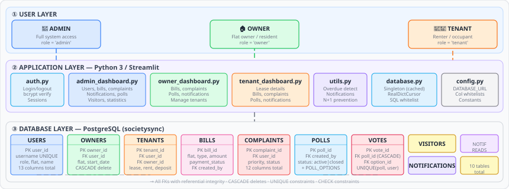
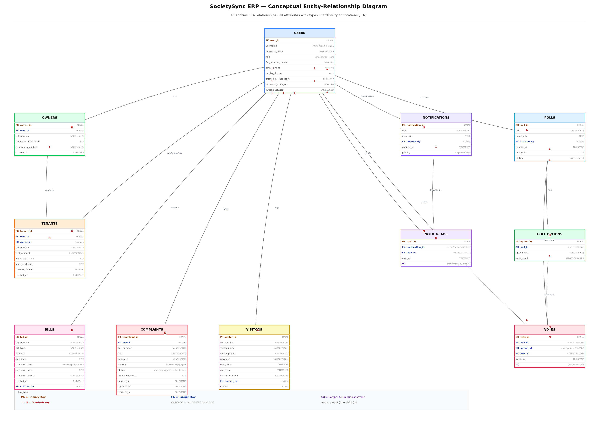
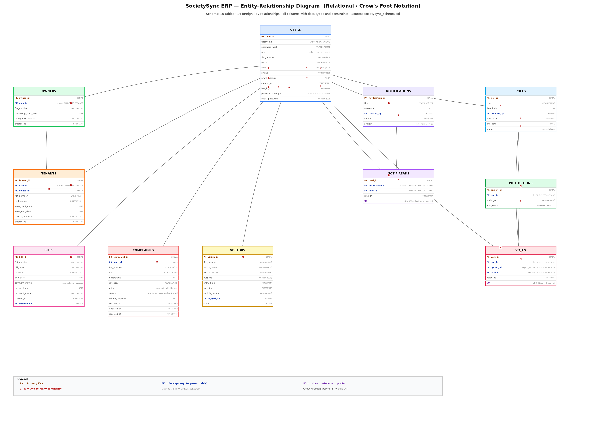
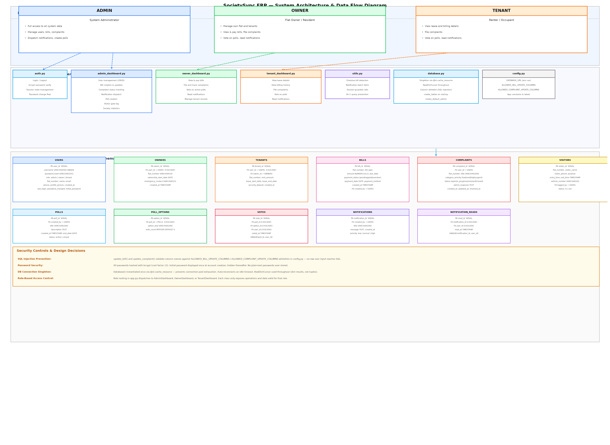

<div align="center">



# SocietySync ERP
### Smart Apartment Management System

[](https://www.python.org/)
[](https://www.postgresql.org/)
[](https://streamlit.io/)
[](LICENSE)
[](https://matjournals.net/engineering/index.php/IJCSAPL/article/view/3168)
[](https://doi.org/10.46610/IJCSAPL.2026.v02i01.001)

<br/>

**A normalized relational database-backed ERP system for residential society management — built with Streamlit + PostgreSQL.**

[📖 Setup Guide](SETUP.md) · [📂 Project Structure](PROJECT_STRUCTURE.md) · [📊 Presentation](SocietySyncERP_Presentation.pptx) · [📑 Report](SocietySyncERP_Report.docx) · [📄 Research Paper](https://doi.org/10.46610/IJCSAPL.2026.v02i01.001)

</div>

---

## 🎯 The Problem We Solve

Residential societies today rely on **WhatsApp groups, paper registers, and spreadsheets** to manage bills, complaints, visitors, and announcements. This creates:
- Lost records and billing disputes with no audit trail
- No centralized tenant/owner directory
- Complaints that go unresolved because there's no ticketing system
- Impossible to query historical data or generate reports

**SocietySync ERP** replaces all of that with a **role-based digital platform** backed by a fully normalized (3NF) PostgreSQL database, accessible from any browser — no installation required for residents.

---

## 📄 Research Publication

> **This project is backed by a peer-reviewed published research paper.**

| Field | Details |
|---|---|
| **Title** | SocietySync ERP — A Normalized Relational Database Architecture for Residential Management |
| **Journal** | International Journal of Computer Science, Algorithms and Programming Languages (IJCSAPL) |
| **Publisher** | MAT Journals, Engineering Series |
| **Year** | 2026 |
| **Volume/Issue** | Vol. 02, Issue 01 |
| **DOI** | [10.46610/IJCSAPL.2026.v02i01.001](https://doi.org/10.46610/IJCSAPL.2026.v02i01.001) |
| **URL** | [View Paper →](https://matjournals.net/engineering/index.php/IJCSAPL/article/view/3168) |

The paper presents the normalized relational schema design, the rationale for 3NF decomposition of the 10-table schema, and the trade-offs evaluated during the DBMS architecture phase of this project.

---

## ⚡ 3-Step Quickstart

```bash
# 1. Clone and enter the project
git clone https://github.com/durgesh-v-shukla/SocietySync-Smart_Apartment_ERP_System.git
cd SocietySync-Smart_Apartment_ERP_System

# 2. Set up environment and database
cp .env.example .env          # Edit .env with your PostgreSQL password
psql -U postgres -c "CREATE DATABASE societysync;"
psql -U postgres -d societysync -f societysync_schema.sql
psql -U postgres -d societysync -f societysync_data.sql

# 3. Install dependencies and run
pip install -r requirements.txt
streamlit run app.py
```

> App opens at **http://localhost:8501** · Default login: `admin` / `admin123`

📋 For the full step-by-step guide (Windows/macOS/Linux), see **[SETUP.md](SETUP.md)**

---

## 🏗️ Architecture



The system is organized in **three layers**:

| Layer | Technology | Responsibility |
|---|---|---|
| **Presentation** | Streamlit (Python) | Role-based dashboards, forms, charts |
| **Application** | Python 3.13 | Auth, business logic, DB pooling |
| **Data** | PostgreSQL 14+ | Normalized schema, constraints, sequences |

---

## ✨ Features

| Module | Admin | Owner | Tenant |
|---|---|---|---|
| **Dashboard** | Society-wide stats & charts | Personal unit overview | Bill & complaint summary |
| **User Management** | Create/manage owners & tenants | View own profile | View own profile |
| **Billing** | Generate bills for any flat | View own bills | Pay bills, view history |
| **Complaints** | View all, respond, resolve | File & track complaints | File & track complaints |
| **Visitors** | Full visitor log | Approve/deny visitors | Log expected visitors |
| **Notifications** | Broadcast announcements | Receive notifications | Receive notifications |
| **Polls** | Create & analyze polls | Vote on active polls | Vote on active polls |

### 🔐 Security Highlights
- **bcrypt** password hashing (cost factor 12) — plaintext never stored
- **Column whitelist** in `config.py` prevents SQL injection via dynamic queries
- **Role-based access control** — each dashboard rendered server-side per role
- **DB singleton** via `@st.cache_resource` — single connection pool per session

---

## 🗄️ Database Schema

### ER Diagrams

<details>
<summary><strong>📊 Conceptual ER Diagram (Chen's Notation)</strong></summary>



> Shows entities, relationships, and cardinalities using Chen's standard notation. Diamonds represent relationships; ovals represent attributes.

</details>

<details>
<summary><strong>📋 Relational Schema Diagram (Crow's Foot)</strong></summary>



> Shows the physical table structure with primary keys, foreign keys, and their relationships in Crow's Foot (IE) notation — the format used by database tools like pgAdmin and MySQL Workbench.

</details>

<details>
<summary><strong>🏛️ System Architecture Diagram</strong></summary>



> Shows how the Python application layer, Streamlit frontend, and PostgreSQL backend interact at the system level.

</details>

<details>
<summary><strong>📐 Schema Tables Reference</strong></summary>

| Table | Primary Key | Description |
|---|---|---|
| `users` | `user_id` | Central user store — all roles (admin, owner, tenant) |
| `owners` | `owner_id` | Owner-specific profile; FK → users |
| `tenants` | `tenant_id` | Tenant-specific profile; FK → users, owners |
| `bills` | `bill_id` | Billing records per flat — maintenance, rent, utilities |
| `complaints` | `complaint_id` | Complaint tickets with status tracking |
| `visitors` | `visitor_id` | Visitor log per flat with entry/exit times |
| `notifications` | `notification_id` | Broadcast announcements created by admin |
| `notification_reads` | `read_id` | Tracks per-user read status of notifications |
| `polls` | `poll_id` | Community polls with open/closed status |
| `poll_options` | `option_id` | Individual options per poll |
| `votes` | `vote_id` | One-vote-per-user enforcement via UNIQUE constraint |

</details>

<details>
<summary><strong>🎓 DBMS Concepts Demonstrated</strong></summary>

| Concept | Implementation |
|---|---|
| **Normalization (3NF)** | Schema decomposed to 3rd Normal Form — no transitive dependencies |
| **Entity-Relationship Modeling** | Full ER diagrams in both Chen's and Crow's Foot notation |
| **Referential Integrity** | `ON DELETE CASCADE` / `ON DELETE SET NULL` FK constraints |
| **Indexing** | B-tree indices on `user_id`, `flat_number`, `poll_id` for query performance |
| **Transactions** | Multi-table inserts wrapped in transactions (e.g., user + owner creation) |
| **Aggregation** | `COUNT`, `SUM`, `AVG` used in dashboard analytics queries |
| **Joins** | `INNER JOIN`, `LEFT JOIN` across normalized tables (e.g., bills + users) |
| **Subqueries** | Correlated subqueries for unread notification counts |
| **Views (Conceptual)** | Dashboard data assembled via composable query functions |
| **Sequences** | Auto-increment PKs via PostgreSQL `SERIAL` with sequence resets in seed |
| **UNIQUE Constraints** | `username`, `email` on users; vote uniqueness `(poll_id, user_id)` |
| **CHECK Constraints** | Role validation, status enumerations |

</details>

---

## 🛠️ Tech Stack

| Technology | Version | Purpose |
|---|---|---|
| [Python](https://python.org) | 3.9+ | Application runtime |
| [Streamlit](https://streamlit.io) | ≥ 1.28 | Web UI framework |
| [PostgreSQL](https://postgresql.org) | ≥ 14 | Relational database engine |
| [psycopg2-binary](https://pypi.org/project/psycopg2-binary/) | ≥ 2.9.9 | PostgreSQL Python adapter |
| [bcrypt](https://pypi.org/project/bcrypt/) | ≥ 4.0.1 | Secure password hashing |
| [pandas](https://pandas.pydata.org) | ≥ 2.0.0 | Data manipulation for tables |
| [plotly](https://plotly.com/python/) | ≥ 5.17.0 | Interactive charts |
| [python-dotenv](https://pypi.org/project/python-dotenv/) | ≥ 1.0.0 | Environment variable management |
| [Pillow](https://python-pillow.org) | ≥ 10.0.0 | Image handling |

---

## 🔑 Default Credentials

> ⚠️ **Change these immediately after first login in a production deployment.**

| Role | Username | Password | Access Level |
|---|---|---|---|
| **Admin** | `admin` | `admin123` | Full system access — user management, all data |
| Owner | Created by admin | Shown once at creation | Flat, billing, complaints, visitors, polls |
| Tenant | Created by admin | Shown once at creation | Bills, complaints, visitors, polls |

---

## 📂 Project Structure

See **[PROJECT_STRUCTURE.md](PROJECT_STRUCTURE.md)** for a detailed explanation of every file and folder in this repository.

---

## 👥 Team

**Department of Computer Engineering, VIT Pune**
*DBMS Course Project — Semester III, Academic Year 2025–2026*
*Guide: Prof. Dr. Disha Wankhede*

| Name | Role | GitHub |
|---|---|---|
| **Durgesh Shukla** | Lead Developer & Database Architect | [@durgesh-v-shukla](https://github.com/durgesh-v-shukla) |
| **Siddhant Gade** | Backend Developer | — |
| **Rushi Solanakar** | Frontend & UI | — |
| **Rohit Shitole** | Database & Testing | — |

---

## 📜 License

This project is licensed under the **MIT License** — see [LICENSE](LICENSE) for details.

---

<div align="center">

Made with ❤️ at **VIT Pune** · Published in **IJCSAPL 2026**

[⬆ Back to top](#societysync-erp)

</div>
